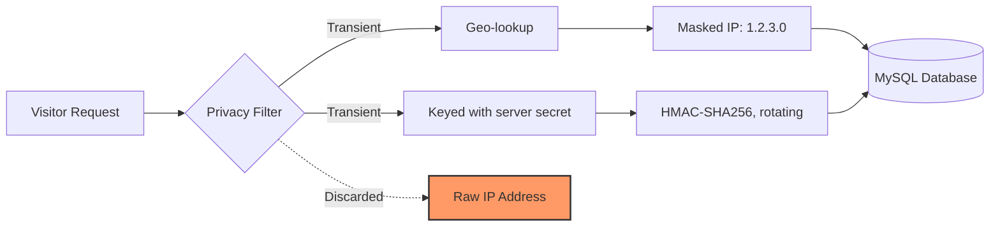

# ViewCounter

[](https://viewcounter.harshankur.com)
[](LICENSE)
[](https://github.com/harshankur/viewcounter/actions/workflows/test.yml)
[](TEST_REPORT.md)
[](https://www.npmjs.com/package/@harshankur/viewcounter)
[](https://www.npmjs.com/package/@harshankur/viewcounter#provenance)

A comprehensive Node.js/Express analytics server for tracking website views with MySQL storage, featuring auto-database creation, advanced tracking, and rich analytics.

## 📖 Documentation
Visit our [Interactive Documentation](https://viewcounter.harshankur.com) for detailed API specifications, debugging tips, and integration guides.

## 🛡️ Built for GDPR Compliance, Privacy-First
**Built for GDPR compliance, by design.** This project is built from the ground up to respect user privacy and adhere to modern ethical standards:
- **Nothing on the visitor's device**: the tracker sets no cookie, uses no localStorage or sessionStorage, and sends no identifier with a view. (The optional admin UI signs its operator in with a session cookie; tracking never sets one.)
- **Counting with and without consent**: where a script that measures a visit needs consent (the German TDDDG § 25, and the EDPB's Guidelines 2/2023 reading of ePrivacy Art. 5(3)), ViewCounter counts in two tiers: [edge counting](#edge-counting) needs no consent, since a Worker in front of the site reports each page request server to server and nothing runs in the browser; the [consent prompt](#the-consent-prompt) loads the tracker, with everything it measures, only once the visitor allows it. Saying no costs the visitor nothing.
- **Data Sovereignty**: You own your data. Analytics never leave your private infrastructure.
- **Minimal Collection**: records what analytics needs, each in a form that does not identify a person directly. [What Gets Tracked?](#what-gets-tracked) lists every field, where it comes from, and how it is stored; the raw IP address, the user agent, and the query string (apart from campaign tags and any parameters a site names as part of its pages) are never stored.
- **Bots left out**: crawlers, link previewers, and automated browsers are recognised and never stored, only counted per minute by name.

### What is still yours to do

ViewCounter does its part, and that is what "built for GDPR compliance" means.
Compliance itself belongs to whoever runs it, and a few things no software can
do for you:

- **Say so.** Mention in your privacy notice that visits are counted, what is
  recorded ([What Gets Tracked?](#what-gets-tracked)), and for how long.
- **Have a legal basis.** For counting page requests at the edge this is
  normally legitimate interest. For a script that measures the visit in the
  browser, many readings of ePrivacy Art. 5(3) (and in Germany § 25 TDDDG)
  ask for consent; the [consent prompt](#the-consent-prompt) collects it.
  Either way, the judgement is yours to make and record.
- **Keep personal details out.** ViewCounter stores what you send in custom
  event data and the optional `sessionId` as given. Do not put names, email
  addresses, or account IDs there.
- **Answer requests.** During its window (a day by default) a visitor hash is
  pseudonymous: whoever holds both the server secret and that window's salt
  could tie it to a known address and browser. A few minutes after the window
  ends the salt is deleted and, as long as no copy of it survives (next point),
  nobody can, you included. What remains is a masked address
  and coarse details. Treat it as personal data all the same: a visitor may
  ask what is held or ask for erasure, which the admin UI does
  ([Deleting, and GDPR](#deleting-and-gdpr)).
- **Keep no copies of the salts.** The `_visitor_salts` table holds the salts
  of the windows now running and nothing else. A copy of an old salt, wherever
  it is, keeps the one thing whose deletion makes old hashes untraceable:
  - **Backups**: exclude the table
    (`mysqldump --ignore-table=<database>._visitor_salts`). Restoring without
    it is harmless: a new salt is made on the next view.
  - **The binary log**: MySQL 8 has it on by default and keeps 30 days, salts
    included. If you do not replicate, turn it off (`skip-log-bin`) or leave
    this database out of it (`binlog-ignore-db`); otherwise shorten
    `binlog_expire_logs_seconds` to what you can accept. MariaDB has it off
    unless you turned it on.

This is a description of the software, not legal advice.

### 🔄 Data Privacy Lifecycle


### 🧬 What happens to the IP?
We believe in total transparency regarding your visitors' data:
1. **Transient Use Only**: The raw IP address is used only in memory, for the country lookup and for deriving the visitor hash. It is never written to the database, and log lines record the *masked* address.
2. **Immediate Masking**: Before being saved, the IP is masked (IPv4 last octet zeroed; IPv6 interface identifier zeroed).
3. **Keyed, Not Just Hashed**: The visitor identifier is an HMAC-SHA-256 keyed with a 32-byte server secret generated on first run and stored at mode `0600`. This matters: an *unkeyed* hash of an IP is reversible by exhausting the 2^32 IPv4 space, which takes about an hour on one CPU core. Without the secret, that search is infeasible.
4. **Rotating**: The hash also mixes in a time window (`UNIQUE_VISITOR_WINDOW_HOURS`), so the same visitor hashes differently after each window and their visits cannot be linked over time.
5. **Salted, and the salt is thrown away**: each window has its own random salt, kept in the `_visitor_salts` table only while the window lasts and deleted a few minutes after it ends, by a timer, whether or not anyone visits. From then on the hashes of that window cannot be recomputed from a known address and browser by anyone, the secret's holder included. The salt is useless without the server secret, which is never in the database.
6. **Automated Guards**: [`tests/privacyFailSafe.test.js`](tests/privacyFailSafe.test.js) asserts that no raw IP or User-Agent reaches either the bound parameters *or* the SQL text of any statement, and that the hash is genuinely keyed. CI runs it on every push, so a change that started storing raw IPs would fail the build.

## ✨ Features

### Core Capabilities
- 🔒 **Security**: Prepared statements, rate limiting, Helmet.js, input validation
- ⚡ **Performance**: Connection pooling with mysql2, duplicate prevention
- 🗄️ **Flexible Database**: Connect to existing DB or auto-create schema
- 🛠️ **Easy Setup**: Interactive CLI wizard with config detection
- 🏥 **Production-Ready**: Health checks, graceful shutdown, structured logging
- 🧑‍💼 **Admin UI**: Browse, search, edit, annotate, and soft-delete recorded views, with batch actions, a trash, and audit logs ([details](#admin-ui))

### Advanced Tracking
- 🧩 **Tracker script**: one `<script>` tag, served by your ViewCounter server ([details](#client-side-integration)): page views, including page changes in single-page apps; how long each page was visible and how far it was scrolled; clicks on links to other sites and on downloads; campaign tags. It stores nothing on the device.
- 🛰️ **Edge counting**: a Cloudflare Worker in front of your site reports each page it serves, server to server, so pages are counted without consent and without any script ([details](#edge-counting))
- 🙋 **Consent prompt**: `consent.js` asks in a small card and loads the tracker only on a yes; a no stops it at once ([details](#the-consent-prompt)). With both, a page load counted at the edge and by the tracker is one view
- 📍 **Pages and sites**: the page path, its title, and which of your sites (hostname) it was on
- 🔗 **Referrer Analysis**: automatic source categorization (search, social, email, campaign, referral, internal, direct)
- 🏷️ **Campaigns**: the five `utm_*` tags of the landing URL, and nothing else from it
- 🌍 **Location**: country built in; region and city with an optional [city database](#location-data)
- 🗣️ **Language**: the visitor's preferred language (its primary subtag only, such as `de`)
- 🖥️ **User Agent Parsing**: browser, OS, and device type, with their versions
- ⏱️ **Engagement**: time on page and scroll depth, measured by the tracker script
- 🎯 **Custom Events**: track button clicks, form submissions, etc., with properties
- 📊 **Analysis**: visitors, visits, bounce rate, visit duration, entry and exit pages, page flow, a weekday-by-hour heatmap, and comparisons with the period before, in the [admin UI](#admin-ui)

## Quick Start

**Requires Node 24 or newer** and a reachable MySQL 8 (or MariaDB 11) instance.
Only the current Node LTS is supported, with no matrix of older runtimes to
maintain.

### 1. Install Dependencies
```bash
npm install
```

### 2. Run Setup Wizard
```bash
npm run setup
```

The wizard will:
- Detect existing configuration (if any)
- Guide you through database setup (connect vs. create mode)
- Configure allowed app IDs and device sizes
- Optionally create `.env` file

### 3. Start Server
```bash
npm start
```

## Configuration

### Database Modes

**Connect Mode** (default): Use existing database
```json
// dbInfo.json
{
    "mode": "connect",
    "host": "127.0.0.1",
    "database": "viewcounterdb",
    "user": "root",
    "password": "your_password"
}
```

On every start, in either mode, the server brings each app table up to the
current schema and creates the log tables it needs, so the user needs `CREATE`,
`ALTER`, and `INDEX` on the database as well as `SELECT`, `INSERT`, `UPDATE`,
and `DELETE`. A user limited to reads and writes, which was enough before 3.1,
fails startup with `MIGRATION_FAILED`. Grant these before upgrading:

```sql
GRANT SELECT, INSERT, UPDATE, DELETE, CREATE, ALTER, INDEX ON viewcounterdb.* TO 'vcuser'@'%';
```

**Create Mode**: Auto-create database and tables
```json
// dbInfo.json
{
    "mode": "create",
    "host": "127.0.0.1",
    "database": "viewcounterdb",
    "user": "root",
    "password": "your_password"
}
```

### Allowed Values
```json
// allowed.json
{
    "appId": ["blog", "portfolio"],
    "deviceSize": ["small", "medium", "large"]
}
```

### Environment Variables
See [`.env.example`](.env.example) for the full surface with prose on each one.

**Required in production**: the server refuses to start without these rather
than running on a guessable default:
- `DB_USER` / `DB_PASSWORD`: refuses to boot while still `root` with an empty password
- `DB_NAME`: database to write into
- `ALLOWED_APP_IDS` (or `allowed.json`): the placeholder `example_app` is rejected
- `CORS_ORIGINS`: browser origins allowed to call the write endpoints

**Recommended**:
- `READ_API_KEYS`: comma-separated keys for the analytics read endpoints. Unset means the read API is disabled.
- `TRUST_PROXY`: hop count or CIDR list. **Never set this to `true`**: trusting every hop lets any caller forge their own IP via `X-Forwarded-For`, which fakes geolocation, inflates unique-visitor counts, and bypasses rate limiting. `true` and `*` are downgraded to one hop with a warning. Your proxy must set `X-Forwarded-For`; `X-Real-IP` alone is not read.
- `VISITOR_SECRET_PATH` / `VISITOR_SECRET`: where the visitor-hash secret lives, or the value itself.
- `ADMIN_PASSWORD`: turns on the [admin UI](#admin-ui) at `/admin`. At least 16 characters. Unset means the admin UI does not exist.
- `EDGE_SECRET`: turns on [edge counting](#edge-counting) at `POST /edge/view`, for the Worker in front of your sites. At least 32 characters, or the server refuses to start; never logged. Unset means the endpoint does not exist.

**Optional**: `DB_MODE`, `PORT`, `LOG_LEVEL`, `RATE_LIMIT_WINDOW_MS`,
`RATE_LIMIT_MAX`, `RATE_LIMIT_MAX_BY_APP`, `APP_RATE_LIMIT_MAX_BY_APP`, `UNIQUE_VISITOR_WINDOW_HOURS`, `ALLOWED_DEVICE_SIZES`,
`VIEW_RETENTION_DAYS`, `TRASH_RETENTION_DAYS`, `VIEW_LOG_RETENTION_DAYS`, `NO_LANGUAGE_APPS`, `ADMIN_SESSION_IDLE_TIMEOUT`,
`ADMIN_SESSION_MAX_AGE`, `GEOIP_CITY_DB`.

### Time zones

Views are timestamped by the database (`NOW()`), and the admin analysis groups
them into UTC days and hours whatever the database's time zone. Run ViewCounter
and the database in the same time zone, so times read back unchanged; in
containers both default to UTC.

### Location data

**Country** comes from the GeoLite2 country database bundled in the
`geoip-country` package: nothing to configure. MaxMind updates it monthly and
the package follows, so update the package (or rebuild your image) now and
then. GeoLite2's licence asks for credit, which the admin UI shows: *This
product includes GeoLite2 data created by MaxMind, available from
https://www.maxmind.com.*

**Region and city** need a city database. Set `GEOIP_CITY_DB` to a
MaxMind-format `.mmdb` file:

- [DB-IP IP to City Lite](https://db-ip.com/db/download/ip-to-city-lite),
  free under CC BY 4.0 and updated monthly; the admin UI credits it as
  *IP geolocation by DB-IP*, as its licence asks;
- or MaxMind GeoLite2 City, which needs a free MaxMind account.

The file is read again whenever it changes, so a monthly job that downloads a
new one over it needs no restart. Without one, region and city stay empty and
everything else works. A configured path that cannot be opened stops the
server from starting, rather than running silently without cities. The IP is
looked up in memory only, like the country, and is never stored.

## Admin UI

A web interface for the data ViewCounter has recorded, served by the same
server at `/admin`. It is built into the package: set a password and it is
there, with no separate deployment and no build step.

```bash
# .env (or the environment of your container)
ADMIN_PASSWORD=<at least 16 characters, e.g. from: openssl rand -base64 24>
TRASH_RETENTION_DAYS=30          # optional; 0 keeps trash until emptied by hand
VIEW_LOG_RETENTION_DAYS=90       # optional; 0 keeps the tracking log forever
ADMIN_SESSION_IDLE_TIMEOUT=7d    # optional; a session ends after this long unused
ADMIN_SESSION_MAX_AGE=30d        # optional; and this long after signing in
```

Then open `https://<your-server>/admin/` and sign in.

To look around without a database, `npm run admin:demo` serves the admin UI
at http://localhost:4173/admin/ over several thousand fake views (password
`playwright-admin-password`). Nothing in it is real traffic.

### What you can do

The admin has five sections. Every one but the two logs shows one app, or
every app together under **All apps**; the choice follows you between them.

- **Overview** (where it opens) is the analysis, for a period (24 hours, 7,
  30, or 90 days, a year, or all time) and an event type:
  - nine headline numbers (visitors, visits, page views, views and events,
    bounce rate, visit duration, pages per visit, time on page, scroll depth),
    each against the period before, with a sparkline; choose one to chart it
    over time, or read every number per period as a table;
  - **Right now**: visitors in the last few minutes (by a new view, or by the
    tracker's report from a page still being read), views per minute over the
    last half hour, and the pages open, refreshed while you look;
  - where visits come from (channels, referrers, referring pages, and every
    campaign tag), pages (top, entry with bounce rate, exit, titles, sites),
    locations (a world map, countries, regions, cities, languages), devices,
    browsers and systems with their versions, custom events and their
    properties, time-on-page and scroll-depth distributions, page flow (which
    page led to which), and a weekday-by-hour heatmap in your time zone;
  - click any row to narrow everything to it (a chip above takes it off
    again), and **Show these views** to open exactly those rows in Views.
  "How these numbers are counted", at the bottom, defines each number.
- **Views** is the data itself: every view and event recorded, one row each,
  the rows every Overview number is computed from. Filter by period, event
  type, and whether an admin changed a row; search by page, title, site,
  source, campaign, note, event, or view ID; sort by any column. **Columns**
  chooses which columns the table has, from everything a view stores, and their
  order; drag a column's edge to resize it (arrow keys work too). The table
  shows as many of your columns as fit its width, in your order, and keeps the
  rest of each row one tap away under it, so a wide screen shows more and
  nothing scrolls sideways. On a phone each view is a card of your first few
  columns. The two logs choose their columns the same way, and the choices are
  remembered in your browser. From here you can:
  - **select several views**, across pages and apps, and act on all at once;
  - **edit content fields**: page path, page title, referrer (the source is
    recalculated from it), device size, event type, and event data. What was
    *observed* about the visitor (time, masked IP, location, language,
    browser, OS, device type, engagement) is never editable, so an edit can
    correct what was viewed but never fabricate who viewed it or when;
  - **add a note** to any view, as a private annotation;
  - **see every stored field** of a view, grouped, in its details;
  - **move views to the trash**, where they stop counting in every statistic
    at once.
- **Trash** holds what was moved there, to **restore** or **erase
  permanently**.
- **Tracking log** lists every tracking request that reached the server and
  what became of it: recorded, a repeat visit, a bot, or refused (and why:
  an unregistered site, an unknown app, a malformed request, a rate limit).
  Views holds only what was recorded; this log also shows what never was, so
  it is where to check that a site is sending views, or find out why some are
  not counted. It sums up the last day, filters by app, request type, and
  outcome, can refresh itself, and opens any entry's view in Views. It is not
  a statistic, and editing or deleting a view never changes it.
- **Admin log** lists every sign-in and every change made here.

The header links to this project's website and names the running version; the
footer links to the documentation, changelog, source, and package, carries the
copyright notice, and credits the location data.

### How the data is kept

| Column | Meaning |
|---|---|
| `public_id` | Random UUID that identifies a view in the UI and API. The auto-increment row number never leaves the server. |
| `admin_modified_at` | Empty when the row is exactly as recorded; otherwise when an admin last changed its content. Notes do not set it. |
| `note` | The admin's annotation, if any. |
| `deleted_at` | Empty for live rows; set when the row went to the trash. |

These columns, the tracking columns in [What Gets Tracked?](#what-gets-tracked),
and the `_admin_log`, `_view_log`, `_tracking_rejections`, and
`_admin_sessions` tables are added automatically when the server starts, in both database modes, whether or not
the admin UI is enabled. The upgrade is additive: nothing is dropped, and
existing rows get their `public_id` on the first start, in batches that each
resume where the last stopped, so a large table is read once. The database user
therefore needs `CREATE`, `ALTER`, and `INDEX` as well as the usual privileges
(see [Database Modes](#database-modes)).

| Table | Holds |
|---|---|
| `_view_log` | The tracking log's accepted half: one row per view or event recorded, with its app, site, request type, view ID, and whether it was unique. |
| `_tracking_rejections` | The tracking log's other half: per minute, how many requests were bots or refused, by app, request type, reason, site, and a short detail (a bot's name, the invalid field). Nothing about who sent them. |
| `_admin_log` | Every sign-in and every change made in the admin. |
| `_admin_sessions` | Signed-in admin sessions: a SHA-256 of the session token (never the token), when it was created and last used, and when the password was last entered. |

The tracking log grows with traffic, so entries older than
`VIEW_LOG_RETENTION_DAYS` (default 90) are removed hourly, in batches, and each
run that removes anything is recorded in the admin log. It holds no personal
data, so this only bounds its size; the views themselves are untouched. The
admin log is never pruned: it is the record of who changed or erased what, and
it grows only with admin activity.

### How long views are kept

Views are kept until an admin deletes them, unless `VIEW_RETENTION_DAYS` is
set: then every hour, views recorded longer ago than that go to the trash, and
are erased with it after `TRASH_RETENTION_DAYS` (when the trash is kept
forever, they are erased at once instead). So a view is gone for good at most
`VIEW_RETENTION_DAYS` plus `TRASH_RETENTION_DAYS` after it was recorded: the
period a privacy notice must name (GDPR Art. 5(1)(e), Art. 13(2)(a)). Each run
that retires anything is recorded in the admin log as a count. A view restored
from the trash after that age is retired again within the hour.

### A language that could say too much

For a site whose visitors' language could hint at their origin (a test trainer
for immigrants, say), list its app in `NO_LANGUAGE_APPS`: its views never keep
a language, from the tracker, an event, or the edge. Give its entry in the edge
Worker's `SITES` `"language": false` too, so the Worker does not even send it.

### Deleting, and GDPR

Deleting is always a soft delete first. Views in the trash are erased for good
after `TRASH_RETENTION_DAYS` (default 30), or straight away with **Erase
permanently**, which exists so a data subject's erasure request (GDPR
Art. 17) can be honoured completely. Each erasure is recorded in the admin
log.

Neither log copies personal data, so erasing a row really erases it:

- the admin log records who acted (a session ID and a masked IP), what they did,
  when, to which view IDs, and *which* fields changed, but never the values;
- the tracking log records that a view was accepted, when, for which app and
  site, and through which endpoint, with no IP, visitor hash, or user agent;
  refused requests and bots are only counted, per minute.

### Security

- `ADMIN_PASSWORD` is its own credential tier. It is independent of
  `READ_API_KEYS` and `ADMIN_API_KEYS`, so leaking one never unlocks another,
  and the server warns if you reuse an API key as the password.
- Signing in issues an `HttpOnly`, `SameSite=Strict` session cookie scoped to
  the admin path (`/admin`, or wherever an embedding app mounts it), marked `Secure` whenever the request arrived over HTTPS (through
  `TRUST_PROXY` behind a proxy).
- Sessions are kept in the database as a hash of their token, so a restart
  does not sign anyone out. One ends after 7 days without use or 30 days after
  signing in (`ADMIN_SESSION_IDLE_TIMEOUT`, `ADMIN_SESSION_MAX_AGE`). Using the
  UI keeps it alive, reading included. If it ends mid-use, a sign-in dialog
  opens over the page and whatever you were doing carries on after it.
- Erasing permanently asks for the password again unless it was entered in the
  last 15 minutes, whatever the session's age; a wrong one counts toward the
  sign-in limit.
- Every change also needs a per-session CSRF token and a matching `Origin`.
- Wrong passwords are rate limited per IP (5 per 15 minutes) and recorded in
  the admin log. Requests refused before the password is checked, such as a
  foreign `Origin` or a malformed body, do not count toward the limit.
- Behind a TLS-terminating proxy, set `TRUST_PROXY` and have the proxy pass
  `X-Forwarded-Proto` and the original `Host`. Otherwise the server believes it
  is serving `http://`, the browser's `https://` `Origin` does not match, and
  every sign-in is refused as cross-origin. The server logs
  `ADMIN_ORIGIN_REJECTED` with both origins when that happens.
- The UI runs under a strict Content Security Policy (no inline script or
  style, no third-party origins, not frameable) and renders everything as
  text: page titles and referrers come from anonymous visitors and can never
  execute.
- Serve it over HTTPS only. The server logs a warning when a sign-in arrives
  over plain HTTP in production.

## API Endpoints

### 📊 Tracking

#### Register View (Enhanced)
```bash
# Basic (backward compatible)
GET /registerView?appId=blog&deviceSize=medium

# Enhanced with page tracking
GET /registerView?appId=blog&deviceSize=medium&page=/blog/my-post&title=My%20Post

# With referrer and campaign tags
GET /registerView?appId=blog&deviceSize=medium&page=/blog/my-post&referrer=https://google.com&utm_source=newsletter&utm_campaign=launch
```

`utm_source`, `utm_medium`, `utm_campaign`, `utm_term`, and `utm_content` are
the only parts of a URL's query that are kept (100 characters each); a landing
that carries one counts as a `campaign`. `sessionId` is optional and yours to
define; the tracker script never sends one.

**Recorded by the server:**
- ✅ Country (and region and city with a [city database](#location-data)), from the IP, which is then masked
- ✅ Browser, OS, device type, and their versions (from the User-Agent, which is not kept)
- ✅ The site visited (the hostname of the request's `Origin`) and the visitor's language (the primary subtag of `Accept-Language`)
- ✅ Referrer domain and source type; a referrer on the same site is `internal`
- ✅ Duplicate prevention (configurable window)
- ✅ Bots are answered but never stored

**Response**:
```json
{"message": "Success!", "duplicate": false, "recorded": true, "id": "0b8c3c1e-3b1c-4f2c-9d4e-1a2b3c4d5e6f"}
```
`id` is the view's public ID, which `/engage` takes. A bot gets
`{"recorded": false}` and a `200`, so it has no reason to retry.

With [edge counting](#edge-counting) on, the view of a page the edge already
recorded completes that view instead of adding one, and `id` is that view's
([One page load, one view](#one-page-load-one-view)). The tracker sends `age`,
the seconds its page had been open (0 to 86400), with each page's first view,
so a view sent late still finds the page load it belongs to.

#### Report Engagement
```bash
POST /engage
Content-Type: text/plain   # or application/json

{"appId": "blog", "id": "<the id /registerView returned>", "ms": 42000, "scroll": 80}
```
How long the page was visible (`ms`, up to 6 hours) and how much of it had been
on screen (`scroll`, 0 to 100). `scroll` is optional: leave it out for a page
that fits its window, where there is nothing to scroll, and the view keeps no
depth and stays out of the scroll averages. The tracker script does this
itself. A later report can only raise either. Each
report also marks the view as seen just now, which keeps its visitor in the
admin's **Right now** for the next few minutes; the tracker script sends one
every half minute while the page is being read. A report
for a view that is unknown, trashed, or older than a day changes nothing and is
counted in the tracking log as refused. `text/plain` is accepted so
`navigator.sendBeacon` can deliver it as the page closes, without a CORS
preflight. Answers `204`.

#### The Tracker Script
```bash
GET /tracker.js
```
The script in [Client-Side Integration](#client-side-integration), served by
the server it reports to, so the two never drift apart. Other sites may load
it (`Cross-Origin-Resource-Policy: cross-origin`), and it is cached for an hour.

#### The Consent Prompt
```bash
GET /consent.js
```
[The consent prompt](#the-consent-prompt), served like the tracker, which it
loads from the same server once the visitor allows it.

#### Report an Edge View
```bash
POST /edge/view
Authorization: Bearer <EDGE_SECRET>
Content-Type: application/json

{"appId": "blog", "url": "https://blog.example.com/post?utm_source=feed", "referrer": "https://www.google.com/",
 "ip": "198.51.100.7", "userAgent": "Mozilla/5.0 ...", "mobile": "?0", "acceptLanguage": "de-DE,de;q=0.9"}
```
Server to server, from the [edge Worker](#edge-counting); it exists only while
`EDGE_SECRET` is set (404 otherwise). Answers `204` whether the view was stored,
merged into the tracker's, or refused as a bot. The full contract is under
[Edge counting](#the-edge-view-contract).

#### Track Custom Event
```bash
POST /event
Content-Type: application/json

{
  "appId": "blog",
  "eventType": "button_click",
  "eventData": {"button": "subscribe", "location": "header"},
  "page": "/blog/my-post",
  "title": "My post"
}
```
**Response**: `{"message": "Event tracked successfully", "recorded": true, "id": "<public ID>", "insertId": 42}`.
`insertId`, the internal row number, is deprecated and will be removed in 4.0;
use `id`. Custom events are never deduplicated.

### 📈 Analytics

> **These endpoints require authentication.** They return your analytics data,
> so every one of them expects a valid key in the `x-api-key` header. Configure
> keys via `READ_API_KEYS` (comma-separated, minimum 32 characters each). With
> none configured the read API returns `503`: it fails closed rather than
> serving your data to anyone who asks.
>
> ```bash
> curl -H "x-api-key: $VIEWCOUNTER_KEY" https://your-server.com/stats/blog
> ```
>
> The tracking endpoints above stay public by design: a browser on your site has
> to be able to reach them. They are bounded by validation, rate limiting, and
> per-app origin binding instead.


#### Get Statistics
```bash
GET /stats/:appId
```
**Response**:
```json
{
  "appId": "blog",
  "stats": {
    "total": 1523,
    "uniqueVisitors": 892,
    "last24Hours": 47,
    "byCountry": [{"country": "US", "count": 423}],
    "byDevice": [{"devicesize": "medium", "count": 789}]
  }
}
```

#### Get Trends
```bash
# Daily trends for last 30 days
GET /trends/:appId?period=daily&days=30

# Hourly trends for last 7 days
GET /trends/:appId?period=hourly&days=7

# Weekly trends for last 12 weeks
GET /trends/:appId?period=weekly&days=84
```

**Response**:
```json
{
  "appId": "blog",
  "period": "daily",
  "days": 30,
  "trends": [
    {"period": "2026-01-01", "count": 45},
    {"period": "2026-01-02", "count": 52}
  ]
}
```

#### Get Referrer Statistics
```bash
GET /referrers/:appId?limit=20
```

**Response**:
```json
{
  "appId": "blog",
  "bySource": [
    {"source_type": "search", "count": 450},
    {"source_type": "social", "count": 230},
    {"source_type": "direct", "count": 180}
  ],
  "byDomain": [
    {"referrer_domain": "google.com", "count": 320},
    {"referrer_domain": "twitter.com", "count": 150}
  ]
}
```

#### Get Browser/OS Statistics
```bash
GET /browsers/:appId
```

**Response**:
```json
{
  "appId": "blog",
  "byBrowser": [
    {"browser": "Chrome", "count": 650},
    {"browser": "Safari", "count": 320}
  ],
  "byOS": [
    {"os": "Windows", "count": 550},
    {"os": "Mac OS", "count": 380}
  ],
  "byDeviceType": [
    {"device_type": "desktop", "count": 890},
    {"device_type": "mobile", "count": 450}
  ]
}
```

#### Get Page Statistics
```bash
GET /pages/:appId?limit=20
```

**Response**:
```json
{
  "appId": "blog",
  "pages": [
    {"page_path": "/blog/post-1", "page_title": "My First Post", "views": 234},
    {"page_path": "/blog/post-2", "page_title": "Second Post", "views": 189}
  ]
}
```

#### Get Session Details
```bash
GET /sessions/:appId/:sessionId
```

**Response**:
```json
{
  "appId": "blog",
  "sessionId": "abc123",
  "events": [
    {
      "id": 1,
      "event_type": "pageview",
      "page_path": "/blog/post-1",
      "timestamp": "2026-01-09T21:30:00.000Z"
    },
    {
      "id": 2,
      "event_type": "button_click",
      "event_data": {"button": "subscribe"},
      "timestamp": "2026-01-09T21:31:15.000Z"
    }
  ],
  "count": 2
}
```

#### Get Recent Views
```bash
GET /views/:appId?limit=10&offset=0
```

#### List Apps
```bash
GET /apps                       # requires x-api-key; filtered to the key's scope
```

#### Register an App
```bash
POST /apps                      # requires an ADMIN x-api-key
Content-Type: application/json

{ "appId": "newcustomer", "origins": ["https://newcustomer.example"] }
```
Creates the table and adds the app to the live allowlist without a restart.

#### Health Check
```bash
GET /health                     # public; reports liveness only
```

## Deployment

### Production with nohup
```bash
nohup node index.js > stdout.log &
# Kill with: kill <pid>
```

### Environment Variables
Set `NODE_ENV=production` to hide error details in API responses.

## What Gets Tracked?

Every field of a view, where it comes from, and the form it is stored in.
Nothing here identifies a person: the one pseudonymous value, the visitor
hash, changes every `UNIQUE_VISITOR_WINDOW_HOURS` and is never shown or
returned by any API.

| Field | Comes from | Stored as | Why |
|-------|-----------|-----------|-----|
| **Timestamp** | Server | When the view was recorded | Everything over time |
| **Masked IP** | Request | IPv4 with the last octet zeroed, IPv6 with the interface identifier zeroed | Abuse investigation at network level, never a person |
| **Visitor hash** | IP and User-Agent, with a secret | HMAC-SHA-256, keyed with a server secret and the window's salt, rotating every window; the salt is deleted when the window ends | Unique views, visitors, and visits; never returned |
| **Country** | IP, looked up in memory | Two-letter code | Where visitors are |
| **Region, City** | IP, with an optional [city database](#location-data) | Names, such as Bavaria and Munich | Where visitors are, more finely |
| **Language** | `Accept-Language` | Primary subtag only, such as `de` (never `de-CH`, never a list); none at all for an app in `NO_LANGUAGE_APPS` | Which languages to write in |
| **Site** | `Origin` of the request; at the edge, the page URL | Hostname only, such as `blog.example.com` | Several sites or subdomains on one app |
| **Page Path** | `page`; at the edge, the page URL's path | The path, such as `/blog/my-post`, with no query string unless the site names parameters as part of its pages (`data-query`, `"query"` in the Worker's `SITES`): then those alone, sorted by name, such as `/?post=my-post` | Which pages are read |
| **Page Title** | `title` | Text, up to 200 characters; empty for a view only the edge saw, since the edge never reads the page | Readable page names |
| **Referrer** | `referrer` (the page's `document.referrer`); at the edge, the `Referer` header | Origin and path only: the query string and fragment are dropped (the tracker never sends them); absent or empty means direct | Where visits come from |
| **Referrer Domain, Source Type** | Derived from the referrer | Hostname; search, social, email, campaign, referral, internal, or direct | Grouping sources |
| **Campaign** | `utm_source`, `utm_medium`, `utm_campaign`, `utm_term`, `utm_content` | Up to 100 characters each; no other query key is ever kept | Which campaigns work |
| **Device Size** | `deviceSize`; at the edge, `Sec-CH-UA-Mobile` (`?1` is small) or else the User-Agent | small, medium, large | Layout decisions |
| **Browser, OS, and versions** | User-Agent, parsed in memory | Names and versions, such as Chrome 140 on macOS 15 | Compatibility |
| **Device Type** | User-Agent | desktop, mobile, tablet, tv, console, wearable | Compatibility |
| **Time on page, Scroll depth, Last seen** | The tracker script's `/engage` report | Milliseconds visible (at most 6 hours); percent of the page seen, empty for a page that fits its window; when the page last reported | Whether pages are read |
| **Event Type, Event Data** | `/event` | Type name; JSON up to 4 kB, as your site sends it | Custom events |
| **Session ID** | `sessionId` (optional) | As your site sends it | Your own grouping; the tracker never sends one |
| **Collected by** | Which side reported the view | `script`, `edge`, or `both` for one page load both reported | Telling edge-only views (no title, no engagement) from complete ones |

**Never stored**: the raw IP address, the User-Agent string, cookies or any
other identifier from the device, any query string or fragment (of the page or
of its referrer) apart from the page's campaign tags and the parameters the
site names as part of its pages, and anything about bots
or refused requests beyond a per-minute count. Before 3.2, a referrer was stored
as sent, query string included; the changelog shows how to strip older rows.

**Visits** are read from the visitor hash the way privacy-first analytics does
it: a visitor's page views belong to one visit until they pause for 30
minutes. Because the hash rotates, the same person on two days is two
visitors, and nothing links them.

Your site's privacy notice should still say that you measure visits this way,
and on what basis: legitimate interest in understanding how the site is used,
for pages counted at the edge; consent, where your law asks for it, for what
the tracker measures in the browser. What you send in `eventData` and
`sessionId` is yours to keep free of personal data.

## Understanding `UNIQUE_VISITOR_WINDOW_HOURS`

This setting prevents counting the same visitor multiple times within a time window.

**How it works:**
- When a view is registered, the system checks whether the same visitor hash
  (the same IP and browser, within the current window) already viewed the app
- If yes: the view is stored as a repeat (`{duplicate: true}`), which counts as
  a view but not as a unique view
- If no: it is stored as a unique view

The window is also how often the visitor hash rotates, so it bounds how long
the same person counts as one visitor. It is the lifetime of the window's salt
as well: the longer the window, the longer a hash stays traceable by whoever
holds the secret and the salt. A day is what privacy-first analytics commonly
uses; lengthen it knowingly.

**Examples:**
- `24` (default): the same visitor counts once per day
- `0`: disable duplicate prevention (the hash still rotates hourly)
- `168`: the same visitor counts once per week

**Note:** Only applies to `pageview` events, not custom events.

### 🛡️ Privacy Guardrails (Fail-Safe)
To guarantee that raw IPs never leak into the database, we've implemented an automated **Privacy Guard** suite ([privacyFailSafe.test.js](tests/privacyFailSafe.test.js)):
- **Query Interception**: Every single SQL `INSERT` is intercepted during tests.
- **Regex Scanning**: We scan all query parameters against raw IP patterns (IPv4 and IPv6).
- **Hard Enforcement**: If the system ever attempts to save an unmasked IP, the test suite immediately fails, preventing accidental privacy regressions.

This makes ViewCounter not just "Privacy-First" by design, but **Privacy-Guaranteed** by automation.

## Security Features

**Trust model.** The two write endpoints (`/registerView`, `/event`) are public
because a browser on your site must be able to reach them. Everything that
*reads* analytics is authenticated. Edge reports (`/edge/view`) come from your
own Worker, server to server, with a credential of their own that can only add
page views.

- ✅ **Authenticated, scoped read API**: every analytics endpoint requires `x-api-key`, compared in constant time, and each key is authorized against the specific `appId` requested. Fails closed when unconfigured.
- ✅ **Separate admin tier**: provisioning apps uses its own credential; a read key cannot provision and an admin key cannot read.
- ✅ **Separate edge tier**: `EDGE_SECRET` authenticates the edge Worker only, compared in constant time, never logged; a refusal is counted in the tracking log. The endpoint does not exist without it, and the reported page must be on one of the app's registered sites.
- ✅ **Per-tenant rate limits**: an `appId`-keyed budget alongside the per-IP limit.
- ✅ **Keyed visitor hashing**: HMAC-SHA-256 with a persisted 32-byte server secret and a per-window salt that is deleted when the window ends, so stored hashes are not reversible to an IP, and after their window not even recomputable.
- ✅ **SQL injection prevention**: every value is a bound parameter; the only interpolated identifier is `appId`, gated by the allowlist.
- ✅ **Explicit CORS allowlist**: no wildcard, and writes can be bound to registered origins per app.
- ✅ **Proxy-aware IP derivation**: client-supplied forwarding headers are not trusted unless `TRUST_PROXY` says so.
- ✅ **Bounded input**: length caps matching every column width, integer ranges on `limit`/`days`/`offset`, a 16 kB body cap and a 4 kB `eventData` cap.
- ✅ **Resource guards**: finite pool queue, per-statement timeout, rate limiting.
- ✅ **No error leakage**: failures return a request id; the detail goes only to the server log.
- ✅ **Security headers** (Helmet.js) and `Cache-Control: no-store` on all analytics responses.
- ✅ **Fail-fast config validation**: insecure defaults stop the boot rather than being silently accepted.
- ✅ **Adversarial regression suite**: [`tests/security.test.js`](tests/security.test.js) covers header spoofing, auth bypass, injection-shaped input, oversized payloads, and prototype pollution.

Report a vulnerability through [private advisory reporting](https://github.com/harshankur/viewcounter/security/advisories/new), not a public issue. See [SECURITY.md](SECURITY.md).

## Usage Patterns

### The deciding question: who holds the visitor's IP?

This determines whether an integration works or silently produces garbage.

**The browser calls ViewCounter directly.** It sees the real visitor IP, so
masking, geolocation, and the visitor hash all work. This is the intended path.

**Your server calls on the visitor's behalf** (SSR, a proxy route, a backend
hook). ViewCounter sees *your server's* address, so every visitor hashes
identically: unique visitors collapses to 1 and geo reports your datacenter
forever. Total views still count. If you must do this, forward the real address
and tell ViewCounter to believe you:

```
X-Forwarded-For: <real visitor IP>     # set by your code
TRUST_PROXY=1                          # otherwise the header is ignored
```

The same goes for the referrer: pass the visitor's own `Referer` (from the
request your server received) as the `referrer` query parameter. ViewCounter
never reads the `Referer` header on the request it receives, because from a
browser that header names the tracked page, not where the visitor came from.

**A process with no visitor at all** (cron, CLI, worker, webhook) should use
`POST /event`. Custom events are never deduplicated, so "unique visitors" is
simply not a meaningful column for those rows.

### Self-hosted blogs

One snippet in the layout every page includes.

| Platform | Where it goes |
|---|---|
| Hugo, Jekyll, Eleventy, Astro | `baseof.html` / `_layouts/default.html` / base layout |
| Ghost | Settings → Code injection → Site Footer |
| WordPress | `wp_footer` hook in the theme, or a small plugin |
| Docusaurus, MkDocs | theme footer partial |
| Next.js, Nuxt, SvelteKit | root layout, **plus a router hook** |

Static generators are the easy case: every navigation is a real page load, so
one fetch in the layout is complete coverage.

**SPAs are the trap.** Client-side routing fires no page load, so you record the
entry page and nothing else. Track again on route change:

```js
router.afterEach(() => track());        // Vue / Nuxt
useEffect(() => track(), [pathname]);   // Next.js app router
```

Run one instance for all your sites: one `appId` each, each with its own table
and its own origin list.

## Multi-Tenancy

Each `appId` is a tenant: its own table, its own origin allowlist, its own
request budget, and its own read credentials.

**`appId` is not a secret.** It travels in a URL the browser fetches, so anyone
can read it from your page source. What stops a stranger writing into your table
is the `origins` list, not the ID being unguessable. Configure origins per app.

### Scoped read keys

A key maps to the apps it may read. Keys in `READ_API_KEYS` are unscoped (they
read everything, which is what you want when all the apps are yours). Scoped
keys live in `allowed.json`:

```json
{
  "appId": ["acme", "globex"],
  "origins": {
    "acme":   ["https://acme.example"],
    "globex": ["https://globex.example"]
  },
  "apiKeys": {
    "<32+ char key for acme>":   ["acme"],
    "<32+ char key for globex>": ["globex"],
    "<32+ char key for you>":    "*"
  }
}
```

Acme's key on `GET /stats/globex` returns **403**. `GET /apps` returns only the
apps in the presented key's scope, so the listing cannot be used to discover
which other tenants exist. A nonexistent app returns the same 403 as an
out-of-scope one, for the same reason.

### Provisioning a tenant at runtime

`POST /apps` creates the app's table, records it, and adds it to the live
allowlist, with no restart and no config edit. It requires an **admin** key
(`ADMIN_API_KEYS`), which is a separate tier: a read key cannot provision, and
an admin key cannot read analytics.

```bash
curl -X POST https://your-server.com/apps \
  -H "x-api-key: $VIEWCOUNTER_ADMIN_KEY" \
  -H "Content-Type: application/json" \
  -d '{"appId": "newcustomer", "origins": ["https://newcustomer.example"]}'
```

Registered apps live in an `_apps` table and are reloaded on every boot, so they
survive restarts. Re-registering is idempotent.

The `appId` becomes a MySQL table name, so it is restricted to 1–64 characters
of letters, digits, underscore, and hyphen, and may not start with an underscore
(reserved for internal tables). Anything else is rejected with 422.

### Per-tenant request budgets

Two independent limits apply to writes:

- `RATE_LIMIT_MAX`: per client IP. The single-abuser backstop.
- `APP_RATE_LIMIT_MAX`: per `appId`. Stops one tenant consuming the budget
  everyone else on the instance depends on. Keyed on `appId` alone, so it cannot
  be bypassed by rotating addresses. Set `0` to disable for single-tenant use.

Either can be set for one app where the general figure does not fit it, as a
list of `appId:number`:

- `RATE_LIMIT_MAX_BY_APP=homepage:600`: tracking requests a minute from one
  address to that app. Such an app is counted on its own, so its traffic does
  not use up the address's budget for your other apps, nor the other way round.
- `APP_RATE_LIMIT_MAX_BY_APP=homepage:5000`: that app's whole budget.

Use these for a site that records far more per visitor than the others, such
as a single-page app that counts every step inside it.

- **Zero means no limit**, in all four settings: as a general figure it
  switches that limit off, as an app's own figure it lifts it for that app.
- **Only tracking requests** (`/registerView`, `/event`, `/engage`,
  `/edge/view`) are limited as an app, and always as the app they are stored
  under. A read or admin call is limited by the general figure whatever it
  names.
- **Edge reports** all come from your Worker's few addresses, so their
  per-address limit counts the visitor's address each report names, with a
  budget of its own. They spend the app's budget like any view: with consent,
  one page load costs the app two requests (the edge's and the tracker's).
- **Mistakes are not silent.** A malformed entry, or an app listed twice, stops
  the server from starting. A figure for an app that is not configured is
  logged as a warning at start, since it would otherwise never apply.

Each limit is applied twice, as two separate budgets of that size: one for
engagement reports (`/engage`) and one for everything else. A page being read
reports every half minute, so each open, active tab costs two reports a minute;
on a shared budget, the readers behind one office address could have used it up
and had their page views refused. Apart, reports can only crowd out other
reports. With the defaults that is room for about 50 readers at once per
address and 500 per app; raise the limits if you expect more, or a reader's
time on page is only updated when their page is hidden or left.

### What is still yours to build

Tenancy here is data isolation and quota, not a billing system. There is no
usage metering, no plan enforcement, and no self-serve signup flow: `POST /apps`
is an admin action you would call from your own onboarding code.

## Deployment Modes

ViewCounter can run three ways. All three share the same route layer
([`routes/analytics.js`](routes/analytics.js)), so behaviour is identical.

### 1. Standalone server

The default. Runs its own Express app on its own port.

```bash
npm start                       # listens on PORT (default 3030)
```

### 2. Mounted as Express middleware

Mount the router into an application you already have, under any path prefix.
Useful when you would rather not run and reverse-proxy a second service.

```js
const express = require('express');
const { createAnalyticsRouter, DatabaseManager } = require('@harshankur/viewcounter');

const app = express();
app.use(express.json({ limit: '16kb' }));

const dbManager = new DatabaseManager({
  mode: 'connect',
  host: '127.0.0.1',
  port: 3306,
  database: 'viewcounterdb',
  user: process.env.DB_USER,
  password: process.env.DB_PASSWORD,
});
// Connects, and brings these apps' tables up to the current schema.
await dbManager.initialize(['blog']);

app.use('/analytics', createAnalyticsRouter({
  dbManager,
  config: {
    allowed: { appId: ['blog'], deviceSize: ['small', 'medium', 'large'], origins: {} },
    auth: {
      // key -> the apps it may read, or '*' for all
      readKeyScopes: { [process.env.VIEWCOUNTER_KEY]: '*' },
      adminApiKeys: [],
    },
    privacy: { visitorSecret: process.env.VISITOR_SECRET },
    server: {
      uniqueVisitorWindowHours: 24,
      // perAppMax: the per-app write budget (omit to disable it).
      // max: per address, applied by the router to engagement reports only;
      //   every other request is yours to limit, as below.
      // perAppMaxByApp / maxByApp: { appId: number } for apps with their own figures.
      rateLimit: { windowMs: 60000, perAppMax: 1000 },
    },
  },
}));
```

Endpoints then live under the prefix: `POST /analytics/event`,
`GET /analytics/stats/blog`, and so on.

Three things the host application owns in this mode, because the router does
not install them itself: `helmet()` and the CORS allowlist, a per-address rate
limit (the router limits only engagement reports per address, and only when
`rateLimit.max` is given), and `trust proxy`.

For [edge counting](#edge-counting), add `edge: { secret: process.env.EDGE_SECRET,
enabled: true }` to the router's `config` (32 characters at least). The router
then limits edge reports per visitor address itself, when `rateLimit.max` is
given, and requests without the secret by their own address; leave
`POST <prefix>/edge/view` out of your own per-address limit, since every report
arrives from the Worker's few addresses. The router reads an edge report's body
itself, after the secret: wrap your JSON parser so it leaves those alone.

```javascript
const { exceptEdgeReports } = require('@harshankur/viewcounter');
app.use(exceptEdgeReports(express.json({ limit: '16kb' }), '/analytics'));
```

The router answers its tracking endpoints with
`Cross-Origin-Resource-Policy: cross-origin` by itself, since other sites'
pages call them. If something of yours ahead of the router can refuse a
tracking request (a rate limiter, say), give those answers the same policy, or
the sending page's console shows a blocked response for each:

```javascript
const { allowTrackingFromOtherSites } = require('@harshankur/viewcounter');
app.use(helmet());
app.use(allowTrackingFromOtherSites('/analytics')); // where the router is mounted
``` Set
`app.set('trust proxy', <hop count>)`, never `true`, or callers can forge
their own IP through `X-Forwarded-For`.

#### Adding the admin UI

The [admin UI](#admin-ui) mounts the same way, at any path. Mount it before
your CORS middleware: it is same-origin only and must never carry the CORS
headers your tracked sites need. Its session cookie is scoped to the path you
choose, and it refuses a password shorter than 16 characters.

```js
const { createAdminRouter, startRetention } = require('@harshankur/viewcounter');

const allowed = { appId: ['blog'], deviceSize: ['small', 'medium', 'large'], origins: {} };

app.use('/admin', createAdminRouter({
  adminRepo: dbManager.admin,
  logRepo: dbManager.logs,
  config: {
    allowed,
    // The retention periods are shown in the UI; pass the ones you schedule below.
    admin: { password: process.env.ADMIN_PASSWORD, trashRetentionDays: 30, viewLogRetentionDays: 90 },
    server: { isProduction: process.env.NODE_ENV === 'production' },
  },
}));

// Hourly: erases trashed views past their retention, and removes view-log
// entries past theirs (0 for either keeps it). Returns a function that stops it.
const stopRetention = startRetention({
  adminRepo: dbManager.admin,
  logRepo: dbManager.logs,
  getAppIds: () => allowed.appId,
  trashDays: 30,
  viewLogDays: 90,
});
```

### 3. Browser client

The server serves its own tracker script at `/tracker.js`, and the consent
prompt that loads it on a yes at `/consent.js`. See
[Client-Side Integration](#client-side-integration).

## Client-Side Integration

### The tracker script

One tag, anywhere in the page:

```html
<script defer src="https://your-server.com/tracker.js" data-app="blog"
        data-hosts="blog.example.com"></script>
```

It records a view of each page, including page changes in single-page apps
(`history.pushState`, `replaceState`, and the back button, each referred by
the page it left); how long each page was visible and how far it was
scrolled, reported when the page is hidden or left and every half minute
while it is being read; clicks on links to other sites (the other site's hostname only);
clicks on downloads (the file name only); and the landing URL's campaign tags.
It stores nothing on the device and sends no identifier, and it skips
automated browsers. A page the browser prerenders on a guess (speculation
rules) sends its view only once it is shown, as the edge never counts a
prerender either.

| Attribute | Default | Meaning |
|---|---|---|
| `data-app` | required | The app ID the views belong to |
| `data-hosts` | every host | Only track on these hostnames, comma-separated, so development servers and previews stay out of the data |
| `data-spa` | `true` | Treat history changes as page views |
| `data-hash` | none | Fragment prefixes, comma-separated (`#docs/,#spec/`), that count as their own page, for pages that route by fragment. Any other fragment stays part of the same page. A matching fragment is stored as part of the page, whole or cut to `data-hash-depth` parts, so list only prefixes whose fragments carry nothing private. As a referrer, such a page is its path alone |
| `data-hash-depth` | every part | With `data-hash`, keep only the first parts of a matching fragment, counted between `/` after its `#` or `#/` (`2`: `#learn/lesson/section` counts as `#learn/lesson`, `#/learn/lesson/section` as `#/learn/lesson`), for routes that name a place within a page, so moving within it is not a new page view. A whole number from 1 to 99; anything else keeps every part. A trailing `/` within the kept parts stays, so `#learn/` and `#learn` are two pages |
| `data-query` | none | Query parameters, comma-separated (`post`), that are part of the page, for sites whose pages differ only in their query (`/?post=hello`). The page is sent as its path and these parameters, sorted by name, each with its first non-empty value; a change to one of them in a single-page app is a new page view. Every other parameter stays in the browser, so list only parameters that carry nothing private. As a referrer, such a page is its path alone. Name the same parameters in the edge Worker's `SITES` entry, so both count a page alike |
| `data-heartbeat` | `true` | Report time on page every half minute while the page is visible and in use, not only when it is hidden or left. It keeps the visitor in the admin's **Right now** while they read one page, and saves the time of a tab the browser closes without warning. It stops after half an hour without any input |
| `data-campaigns` | `true` | Send the landing URL's `utm_*` tags with the view |
| `data-outbound` | `true` | Record clicks on links to other sites, as `outbound` events |
| `data-downloads` | `true` | Record clicks on downloads (pdf, zip, dmg, docx, and so on), as `download` events |
| `data-respect-dnt` | `false` | Send nothing when the browser's Do Not Track is on |

Custom events: `window.viewcounter.track('signup', { plan: 'pro' })`.

For it to reach the server:

- the site's origin is in `CORS_ORIGINS`, and, if the app is bound to its
  sites, registered for the app;
- with a Content Security Policy on the site, `script-src` and `connect-src`
  allow the ViewCounter server.

Check the admin's **Tracking log** after adding it: every request shows up
there, recorded or not, with the reason when it was refused. A site missing
from `CORS_ORIGINS` shows up as "site not allowed: CORS_ORIGINS", counted from
the browser's preflight, since the request itself never arrives.

### The consent prompt

Where a script that measures a visit needs the visitor's consent, load
`consent.js` instead of `tracker.js`. It asks, and loads the tracker only on a
yes:

```html
<script defer src="https://your-server.com/consent.js" data-app="blog"
        data-hosts="blog.example.com" data-privacy-url="https://blog.example.com/privacy"></script>

<!-- in the footer, so the answer can be changed at any time -->
<button type="button" data-viewcounter-consent>Privacy settings</button>
```

The prompt is a small card in the bottom corner. It blocks nothing, takes no
focus by itself, and says plainly what a yes changes: without consent only
which pages are opened is counted (by the [edge](#edge-counting)); with it,
also how long a page stays open, how far it is scrolled, and which links and
features are used. **Allow** and **No thanks** look the same, side by side. A
no loads nothing and costs the visitor nothing. **Escape** puts the card away
for that page without an answer. It is in German or English. A card that
appears by itself is announced once to screen readers, politely, since it does
not take focus; opened from a settings link, it takes focus, and gives it back
when it closes.

The answer is kept in `localStorage` under `viewcounter-consent:<key>`
(`granted` or `denied`, with the time it was given, as `granted@<ms>`), where
the key is the app ID or `data-consent-key`, the one thing on the device, which
the visitor asked for. It holds for a year (`data-consent-days`); then it is
removed and the visitor is asked again, as supervisory authorities expect of a
consent. Where storage is unavailable (a private window, blocked site data), the
visitor is asked on every page and the answer holds for that page. A yes in
one tab holds in the site's other tabs too.

| Attribute | Default | Meaning |
|---|---|---|
| `data-app` | required | The app ID, as for the tracker |
| `data-hosts` | every host | Only on these hostnames; anywhere else it does nothing at all, so development servers show no prompt |
| `data-consent-days` | `365` | How long an answer holds before the site asks again, 1 to 3650 days. The answer is stored with the day it was given; one that has run out is removed and the visitor is asked afresh |
| `data-consent-key` | the app ID | The name the answer is kept under (letters, digits, `_` and `-`). Apps on one site that share a key share one answer, so a site whose blog is another app asks once |
| `data-privacy-url` | none | The privacy notice the prompt links to (opened in a new tab), read each time the prompt is shown (an open prompt follows a change at once), so a site that switches its language in place can point it at the notice in that language. No link without it |
| `data-lang` | from `<html lang>` | `de` or `en`. Without it, German when the page's language starts with `de`, English otherwise, read each time the prompt is shown (an open prompt follows a change at once), so a site that switches its language in place is asked in the one it shows |
| `data-ui` | shown | `none`: never show the prompt by itself; the site asks through the API |
| `data-edge` | `true` | `false` when no edge Worker counts the site's pages, so the prompt says nothing is counted without consent |
| `data-spa`, `data-hash`, `data-hash-depth`, `data-query`, `data-heartbeat`, `data-campaigns`, `data-outbound`, `data-downloads`, `data-respect-dnt` | as the tracker's | Passed on to the tracker it loads |

**API**, on `window.viewcounterConsent`:

| | |
|---|---|
| `open()` | Show the prompt (again), with the current answer, focus in it |
| `status()` | `'granted'`, `'denied'`, or `'unset'` |
| `grant()`, `deny()` | Answer for the visitor, from a consent tool of your own |

Every change fires a `viewcounter:consent` event on `window`, with
`event.detail.status`. A click on any element with the attribute
`data-viewcounter-consent` opens the prompt. Make it a `<button type="button">`:
it opens a question and goes nowhere, and a link to `#` would change the
address where the script is blocked.

Load `consent.js` instead of `tracker.js`, never both: a tracker the page loads
itself before the prompt runs cannot know to wait. (One loaded after it does
wait, and is not loaded a second time.)

**Withdrawal is immediate.** The tracker asks `window.viewcounterConsent`
before every request it sends (page views, engagement reports, heartbeats,
links out, downloads, custom events), so after a no it sends nothing more,
without a reload. A view held back that way (the page changed while the answer
was no) goes once the answer is yes again. A tracker loaded directly, with no
`consent.js` on the page, behaves as it always has.

**Styling.** The card lives in a closed shadow root, so the page's CSS cannot
reach into it, and it follows the visitor's light or dark preference. These
custom properties, set on the `viewcounter-consent` element (or any ancestor),
change it:

| Property | Default (light / dark) |
|---|---|
| `--viewcounter-consent-font` | the system font stack |
| `--viewcounter-consent-background` | `#ffffff` / `#1c2128` |
| `--viewcounter-consent-color` | `#1f2328` / `#e6edf3` |
| `--viewcounter-consent-border` | `#d0d7de` / `#3d444d` |
| `--viewcounter-consent-radius` | `12px` |
| `--viewcounter-consent-shadow` | a soft drop shadow |
| `--viewcounter-consent-button-background` | `#f6f8fa` / `#2d333b` |
| `--viewcounter-consent-button-color` | the text color |
| `--viewcounter-consent-button-border` | the border color |
| `--viewcounter-consent-link` | `#0b5cad` / `#6cb6ff` |
| `--viewcounter-consent-focus` | the link color |
| `--viewcounter-consent-z-index` | `2147483000` |

```css
viewcounter-consent { --viewcounter-consent-font: "Inter", sans-serif; --viewcounter-consent-radius: 4px; }
```

With a Content Security Policy, `script-src` must allow the ViewCounter server
(the tracker loads from the same place; a `nonce` on the `consent.js` tag is
passed on to it) and `connect-src` too. The card's styles are a constructed
stylesheet, which `style-src` does not block.

Mention the stored answer in your privacy notice, with the rest of what is
counted.

### Without the script

The same requests by hand. Keep it this way round: nothing stored on the
device, no identifier generated in the browser.

```javascript
const params = new URLSearchParams({
  appId: 'blog',
  deviceSize: innerWidth < 768 ? 'small' : innerWidth < 1200 ? 'medium' : 'large',
  page: location.pathname,
  title: document.title,
  referrer: document.referrer,
});
// Only the campaign tags from the query string.
for (const key of ['utm_source', 'utm_medium', 'utm_campaign', 'utm_term', 'utm_content']) {
  const value = new URLSearchParams(location.search).get(key);
  if (value) params.set(key, value);
}
const { id } = await fetch(`https://your-server.com/registerView?${params}`).then((r) => r.json());
// Later, when the page is hidden: how long it was visible, and how far scrolled.
navigator.sendBeacon('https://your-server.com/engage',
  new Blob([JSON.stringify({ appId: 'blog', id, ms: 42000, scroll: 80 })], { type: 'text/plain' }));
```

### Track Custom Events
```javascript
async function trackEvent(eventType, eventData) {
  await fetch('https://your-server.com/event', {
    method: 'POST',
    headers: {'Content-Type': 'application/json'},
    body: JSON.stringify({
      appId: 'blog',
      eventType,
      eventData,
      page: window.location.pathname
    })
  });
}

// Track button click
document.querySelector('#subscribe-btn').addEventListener('click', () => {
  trackEvent('button_click', {button: 'subscribe', location: 'header'});
});
```

## Edge Counting

Counting without consent, and without any script: a
[Cloudflare Worker](edge/) in front of your site sees each request for an HTML
page and reports it to ViewCounter, server to server, after the visitor has the
page. Only what that request itself carried is reported, and the Worker reduces it
before it leaves Cloudflare:

- the page URL, as its origin, path, and `utm_*` tags (nothing else of the
  query is sent),
- the `Referer` header, as an origin and a path,
- the visitor's address (`CF-Connecting-IP`; masked and hashed as always),
- the `User-Agent` (parsed, never stored),
- `Sec-CH-UA-Mobile` (a phone counts as `small`),
- `Accept-Language` (its primary subtag).

Two optional Worker vars follow the tracker's options: `RESPECT_DNT: "true"`
reports nothing for a browser that sends Do Not Track or Global Privacy
Control (as `data-respect-dnt`), and `CAMPAIGNS: "false"` leaves the `utm_*`
tags out (as `data-campaigns`). Set them to match the site's tracker options.
A page requested with no user agent at all is a script, not a visitor, and is
counted as a bot.

Nothing is read from or stored on the device, and the page sends nothing
itself, so there is no page title, no window size, no time on page, and no
scroll depth: those come from the tracker, with consent. A failed or slow
report (five seconds at most) is dropped and never touches the visitor's
response, and no cookie or other header is forwarded.

### Setting it up

1. **The server.** Set `EDGE_SECRET` to a random value of at least 32
   characters (`openssl rand -hex 32`) and restart. Every app to be counted
   at the edge needs its sites in `origins` in `allowed.json` (an app with no
   sites registered takes no edge reports, since there is nothing to check the
   page's URL against).
2. **The Worker.** The [`edge/`](edge/) folder is deployable on its own: in
   Cloudflare, Workers & Pages, create a Worker from the repository with root
   directory `edge/` (Workers Builds), or run `npx wrangler deploy` there. In
   [`edge/wrangler.jsonc`](edge/wrangler.jsonc), replace `routes` and `SITES`
   (which list the author's own sites) with yours, and `VIEWCOUNTER_URL` with
   your server. Each route's zone must be on Cloudflare, with the DNS record
   proxied.
3. **The secret.** Give the Worker the same value:
   `npx wrangler secret put EDGE_SECRET`, or in the dashboard under the
   Worker's Settings, Variables and Secrets.
4. **Check** the admin's **Tracking log**: edge views show up as "Edge page
   view"; a Worker with the wrong secret shows up as "wrong edge secret", a
   page on a site not registered for its app as "site not allowed".

`SITES` is a JSON string mapping a hostname to its app ID, or to a list of path
prefixes and their apps, where the longest prefix the path starts with wins:

```json
{
  "example.com": "homepage",
  "docs.example.com": [{ "prefix": "/blog/", "app": "docsblog" }, { "prefix": "/", "app": "docs" }],
  "notes.example.com": { "app": "notes", "query": ["post"] }
}
```

A site whose pages differ only in their query (`/?post=hello`) names those
parameters with `"query"`, on a hostname's object or on a prefix rule, as the
tracker's `data-query` does: they are reported as part of the page, sorted
by name (so the order either side lists them in does not matter), and the
rest of the query never leaves the Worker. Up to ten
names of letters, digits, `_`, `-` and `.`, never a `utm_` tag.
`"language": false` on an entry sends no `Accept-Language` for that site (see
`NO_LANGUAGE_APPS`).

The Worker counts a request only when all of these hold: it is a `GET`; it is
for a top-level page (`Sec-Fetch-Dest: document` and, where the browser sends
it, `Sec-Fetch-Mode: navigate`; from a browser that sends neither, an `Accept`
that asks for `text/html`); it is not a prefetch or prerender (`Sec-Purpose`
or `Purpose`); the site answered it with a 2xx and `Content-Type: text/html`,
or with `304 Not Modified` (a returning visitor's browser revalidating the
page it holds, a view all the same, counted only on `Sec-Fetch-Dest: document`
and not for a path naming another kind of file, such as `/report.pdf`); and
its hostname (and path) maps to an app. Everything else, assets included, passes through untouched. Every request
on the routes runs through the Worker, which counts against Cloudflare's
Workers request allowance.

To rotate the secret, set the new value on the server and the Worker one after
the other; the reports in between are refused (and counted as such), so do it
at a quiet hour.

### The edge view contract

`POST /edge/view`, with `Authorization: Bearer <EDGE_SECRET>` and a JSON body
(at most 16 kB, like every body):

| Field | Required | Meaning |
|---|---|---|
| `appId` | yes | An allowed app |
| `url` | yes | The full page URL requested, absolute `http(s)`, up to 2048 characters. Its origin must be one of the app's `origins` |
| `ip` | yes | The visitor's address, up to 45 characters; one that does not parse is a `400` |
| `referrer` | no | The raw `Referer` header, or `""`, up to 2048 characters |
| `userAgent` | no | The raw `User-Agent`, up to 1024 characters |
| `mobile` | no | The raw `Sec-CH-UA-Mobile` (`?1` or `?0`) |
| `acceptLanguage` | no | The raw `Accept-Language`, up to 512 characters |
| `pageQuery` | no | The query parameters of `url` that are part of the page, as a list of up to ten names (letters, digits, `_`, `-`, `.`; no `utm_` tag). The page is stored as the path and these parameters, sorted by name, each with its first non-empty value; every other parameter is dropped. Absent or `null` means none; anything else is a `422` |

Absent optional fields may also be `null`. Answers:

| Status | When |
|---|---|
| `204` | Stored, merged into the tracker's view of the same page load, or refused as a bot (counted by name) |
| `400` | The address does not parse |
| `401` | No or a wrong secret; counted in the tracking log, logged without the header |
| `403` | The page is not on one of the app's registered sites |
| `404` | Edge counting is off: no `EDGE_SECRET` |
| `422` | A field is missing, too long, or of the wrong type, or the app is unknown |
| `429` | Too many from this visitor's address, or for this app |

There is no CORS and no `Origin` check: it is not for browsers. The per-address
limit counts the visitor's address from `ip`, not the Worker's. A request
without the secret is limited by its own address instead, and refused before
its body is even read, however malformed or large; its 401 is counted under no
app (its body is not to be trusted).
The app's budget is spent last, after the secret, the fields, the site, the
visitor's limit, and the bot check, so neither a crawler nor one busy visitor
can use it up.

### One page load, one view

With the edge counting and the tracker allowed to run, one page load is
reported twice: by the Worker as it serves the page, and by the tracker a
moment later. They become one view, and each view records which side
collected it (`collected_by`: `script`, `edge`, or `both`):

- **The same visitor**, on IPv4, is the same visitor hash, made from the full
  address and the user agent: a masked IPv4 address is a whole /24 (a
  carrier's NAT pool, neighbours at one provider), far too wide to stand for
  one visitor. On IPv6 it is what both reports store alike: the masked /64 and
  the browser, its version, the system, its version, and the device type. Not
  the hash there, because a device with several IPv6 addresses (the privacy
  addresses macOS, iOS, Windows, and Android use by default) sends the page
  request from one and the tracker's request from another. A /64 that
  carries no network (the all-zero one, from `::1`, or a link-local one)
  needs the hash, as IPv4 does.
- **The tracker's view** looks for a view of the same page by the same visitor
  that the edge recorded around when the page was loaded (the tracker sends
  `age`, how long ago that was), within two minutes either side, and that
  nothing has merged into yet; of several, the one nearest that moment (the
  same hash only breaks a tie, so the same page in two tabs never crosses). If
  there is one, it fills in what only the page knows (its title, the window's
  size bucket, the session, a hash route) and marks it `both`, and
  `/registerView` answers with that view's `id`, so engagement attaches to it.
  The answer has the same shape as ever. A visitor who took a while to answer
  the prompt is still one view, and the same page open in two tabs (or two
  identical browsers behind one address) is two views, each completed by its
  own tracker; a page load after the tracker's own is never taken for it.
- **The edge's report**, in the rare case it arrives after the tracker's
  view, only marks that view `both`.
- **A merged view carries the tracker's visitor hash**, which the tracker's
  other views of the visit (a single-page app's navigations, its events)
  carry too, so the visit reads as one. Where the hash changes, the view's
  uniqueness is decided again for that hash, as the tracker's own view would
  have been: `is_unique` always describes the hash beside it.
- **A single-page app's navigations** come from the tracker alone and are
  stored as views of their own, as always.
- **The page** is compared without a fragment, which only the tracker sends
  (for hash-routed pages).
- **Two reports arriving at the same instant** may each find nothing and both
  be stored. The window is short and `collected_by` tells them apart; it is
  accepted rather than locked against.
- **Two people in one IPv6 /64** (one household, say), with the same browser
  and system versions, opening the same page within the window, may be taken
  for one: the tracker's view of one may complete the edge's view of the
  other. If the other's page load reached the edge too, its tracker view is
  stored as its own and only a title or a session lands on the wrong one of
  the two; if it did not (the page came from the browser's cache), two page
  loads are counted as one. It is accepted; each view is merged at most once.
  On IPv4 two people are merged only when they also share the full address
  and the user agent, and then the counter takes them for one visitor anyway.
- **Page loads before consent stay edge-only**, with the hash of the address
  the page request came from. On IPv6 that can differ from the tracker's, so
  a visitor whose later loads merged can still appear as two visitors, or two
  visits, in the analysis.
- **Both sides must still see the same network.** A browser that reaches your
  site over IPv6 and the ViewCounter server over IPv4 (or the other way
  round) has two masked addresses, and its page load is two views. Serve both
  from the same network setup (behind Cloudflare, both normally are).
  Likewise the app: a page the Worker files under one app (by `SITES`) and
  the tracker under another (by `data-app`) is never merged. A prefix such as
  `/blog/` does not cover `/blog`.

A merge adds no entry to the tracking log, which lists stored views: a page
load counted by both sides shows up once, under whichever side came first.

Rows from before 3.6 read `script`: the column is added on startup (schema v8)
with that default.

## Testing

### Running Tests

```bash
# Run all tests with coverage (auto-generates TEST_REPORT.md)
npm test

# Run tests in watch mode (for development)
npm run test:watch

# Run tests and persist database for inspection
npm run test:persist

# The fast gate CI runs: lint and Jest with coverage, no browser, no report
npm run test:ci

# Run only the admin UI and tracker tests in a real browser (Playwright)
npx playwright install chromium   # once
npm run test:ui
```

`npm test` includes the Playwright suite, so run `npx playwright install
chromium` once before the first run.

CI runs everything except the browser tests: lint, Jest with its coverage
floor, the dependency audit, the tarball check, and the end-to-end run against
a real MySQL. It does not download a browser, to save CI time, so the browser
tests are a local step: run `npm run test:ui` whenever you change anything
under `admin/` or `tracker/`, and the full `npm test` before a release.

### Test Database

**Automatic Management:**
- ✅ Creates fresh `viewcounterdb_test` database before each test run
- ✅ Populates with realistic test data
- ✅ Automatically cleaned up after tests complete

**Persist Database for Debugging:**
```bash
# Keep test database after tests
npm run test:persist

# Or set environment variable
PERSIST_TEST_DB=true npm test
```

When persisted, you can inspect the database:
```sql
USE viewcounterdb_test;
SHOW TABLES;
SELECT * FROM test_app_1;
```

To manually remove:
```sql
DROP DATABASE viewcounterdb_test;
```

### Test Reports

**Automatically generated after every test run:**
- ✅ **Terminal output**: Immediate test results and coverage
- ✅ **TEST_REPORT.md**: Comprehensive markdown summary (auto-generated)
- ✅ **test-report.html**: Visual test results with dark theme
- ✅ **coverage/index.html**: Interactive code coverage report

All reports are created in the project root directory.

### Test Coverage

The test suite includes:

#### Unit Tests
- ✅ **UserAgentParser**: Browser, OS, and device detection
- ✅ **ReferrerParser**: Traffic source categorization

#### Integration Tests
- ✅ **Health Check**: Server status monitoring
- ✅ **View Registration**: Basic and enhanced tracking
- ✅ **Custom Events**: Event tracking with metadata
- ✅ **Statistics**: Aggregated analytics
- ✅ **Trends**: Time-based analytics
- ✅ **Referrers**: Traffic source analysis
- ✅ **Browsers**: Browser/OS/device breakdown
- ✅ **Pages**: Page view statistics
- ✅ **Sessions**: Session journey tracking
- ✅ **Rate Limiting**: Request throttling

### Test Scenarios

All endpoints are tested with:
- ✓ Valid inputs
- ✓ Invalid inputs
- ✓ Missing parameters
- ✓ Edge cases
- ✓ Security validation

## Releasing

Publishing to npm is a manual, deliberate step: an npm version number can never
be reused, so it is not wired to run on merge.

```bash
npm version patch|minor|major   # bump package.json + CHANGELOG in one commit
git push                        # land the bump
gh workflow run release.yml     # test, tag, publish with provenance, release
```

The package is published as **`@harshankur/viewcounter`** (scoped). npm rejects
the unscoped `viewcounter` as too similar to the existing `view-counter`; a
scope is its own namespace, so the collision does not apply.

**No secret is involved.** Authentication is OIDC via npm Trusted Publishing:
the package is bound to this repository and to `release.yml` specifically, and
the runner exchanges a short-lived id-token for a registry credential at publish
time. There is no `NPM_TOKEN` to rotate or leak, and nothing to be caught by
npm's deprecation of 2FA-bypassing tokens. Every release carries a signed SLSA
provenance attestation, verifiable with:

```bash
npm audit signatures
```

To publish automatically on every version bump instead, uncomment the `push:`
trigger in `.github/workflows/release.yml`.

## License

[MIT](LICENSE) - Do whatever you want with this, just don't sue us.